# Niche

Website for **NICHE**, a clothing brand making embroidered pieces, one-of-one items and custom designs. Visitors browse collections and send order requests; the brand manages the catalog, every text and photo on the site, and incoming requests from a built-in admin panel.

**Live site: [niche13.vercel.app](https://niche13.vercel.app)**

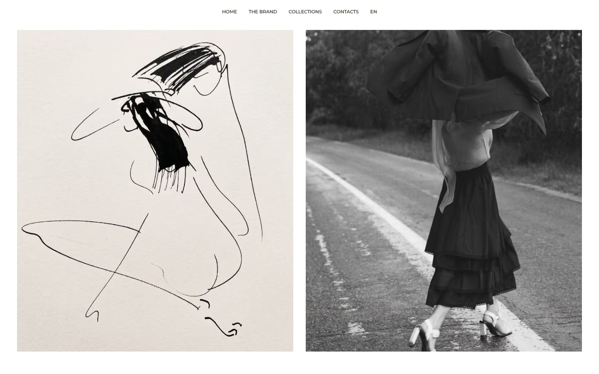

## Features

### Storefront

- **Collections and categories.** Categories either group collections (T-shirts, Hoodies) or open a product catalog directly (Bags).
- **Product pages** with sizes, colours, price and sale price, and stock tracked per size. A piece is marked "out of stock" automatically once every size runs out.
- **Four request forms**, one for each way of ordering:
  - *Find your piece*: pieces from the catalog;
  - *Find your one*: one-of-one items;
  - *Choose your design*: illustrations on a chosen garment;
  - *Make it real*: a custom design, uploaded as an image or PDF.
- **Russian and English.** Russian lives at the plain addresses (`/collections`), English at `/en/collections`.
- **Responsive layouts** for phone, tablet and desktop, matched to the Figma designs.

### Admin panel (`/admin`)

- **Requests**: every submission with its contact details, order lines and uploaded files, plus statuses, search and deletion.
- **Catalog**: products, collections and categories with photo uploads and ordering, and per-size stock.
- **Content**: every text and photo on the site is edited here, in both languages. Nothing is hardcoded.
- **Notifications** about new requests by email (Gmail SMTP or Resend) and Telegram, configured in the panel. Keys are stored encrypted.
- **Visit statistics** without cookies or third-party trackers.

### Security

- Sign-in with **two-factor authentication** (TOTP), protected against brute force by per-IP and per-account limits.
- **Row Level Security** in Postgres. Admin writes go through the signed-in user's session, never a service key.
- **Uploaded files are sanitized**: images are rebuilt from their pixels, so hidden payloads and EXIF data are dropped, and PDFs are checked for active content.
- **Request forms are protected** by validation on the server, a honeypot field, a minimum fill time and rate limits.
- **Hardened HTTP**: a strict Content Security Policy, HSTS, and frame and opener isolation.

### SEO

- The sitemap is generated from the catalog and lists both languages of every page.
- Pages carry hreflang links, canonical addresses and descriptions.
- Shared links get Open Graph preview cards.
- Product pages include structured data (photo, price, availability).
- The search title and description are editable in the admin panel.

## Screenshots

| Collections | Collection |
| --- | --- |
| 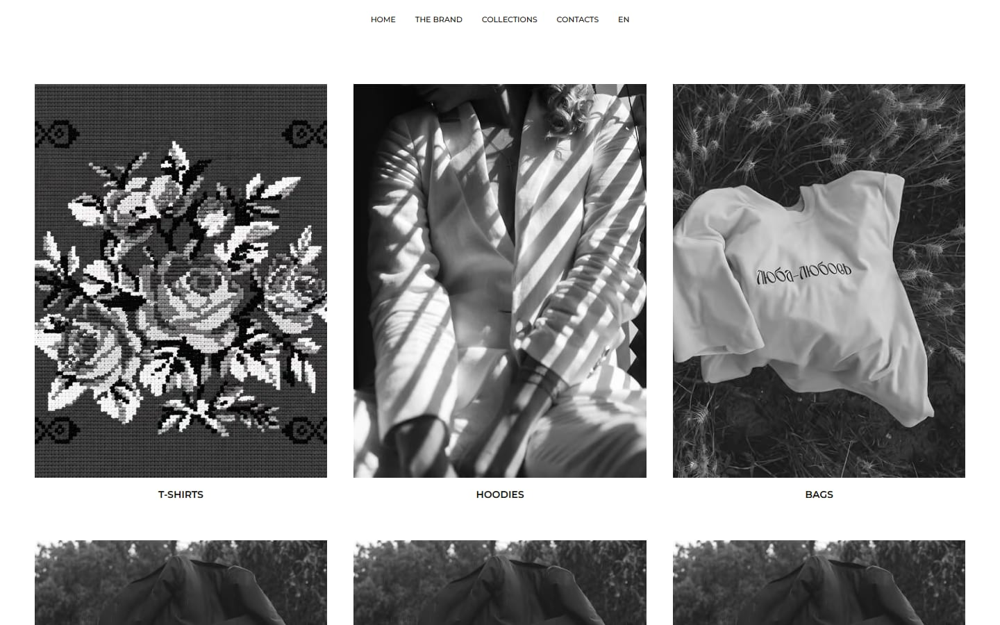 | 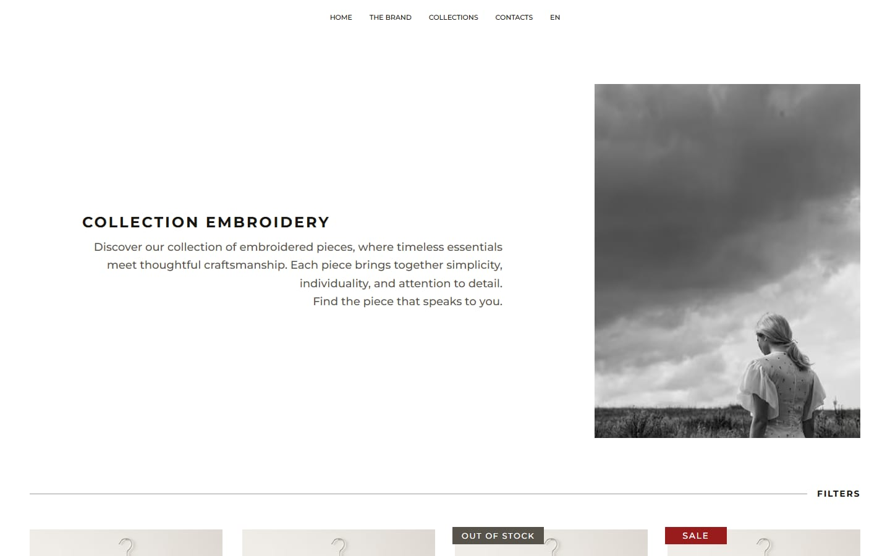 |
| **Product grid** | **Product** |
| 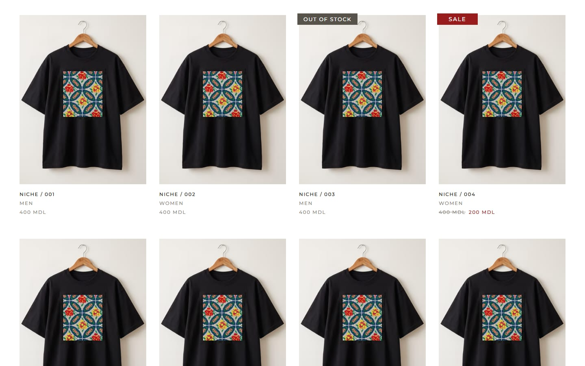 | 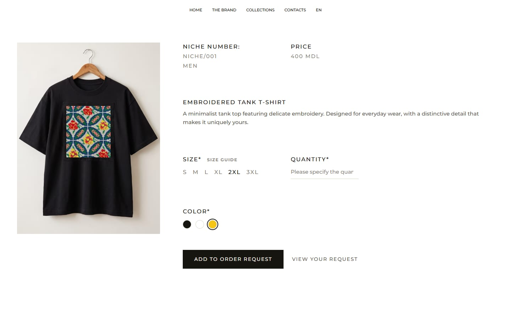 |
| **Order request** | **Custom design** |
| 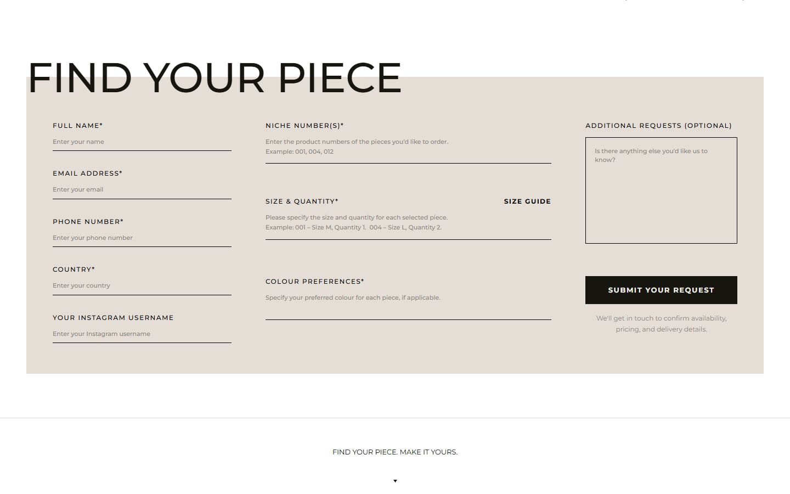 | 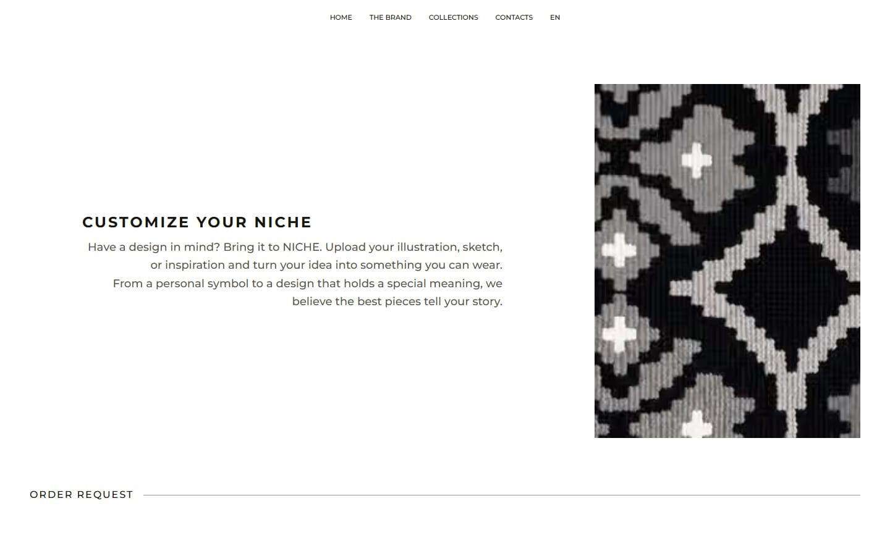 |
| **The brand** | **Admin sign-in** |
| 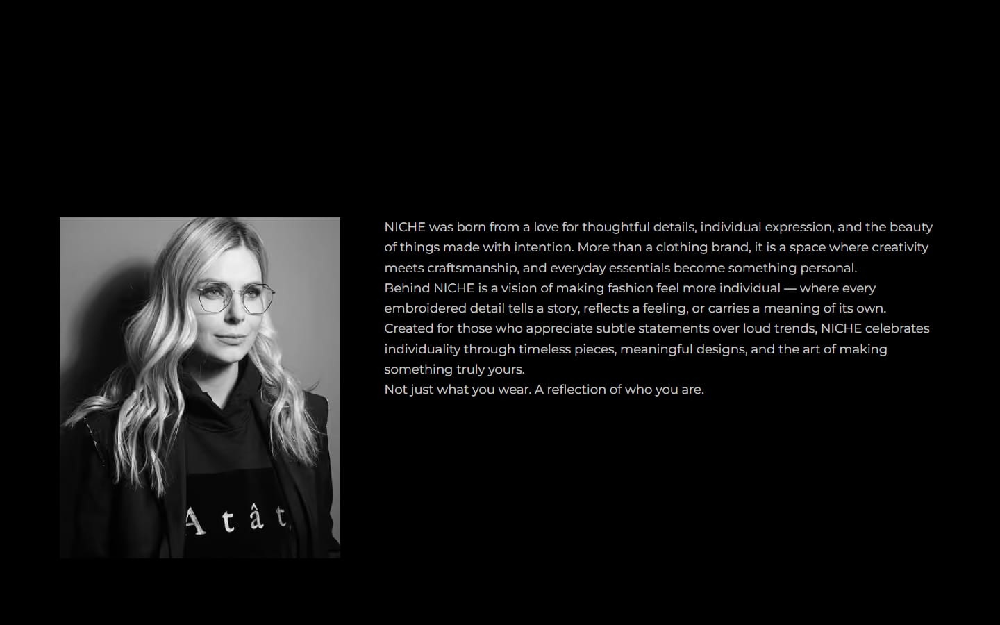 | 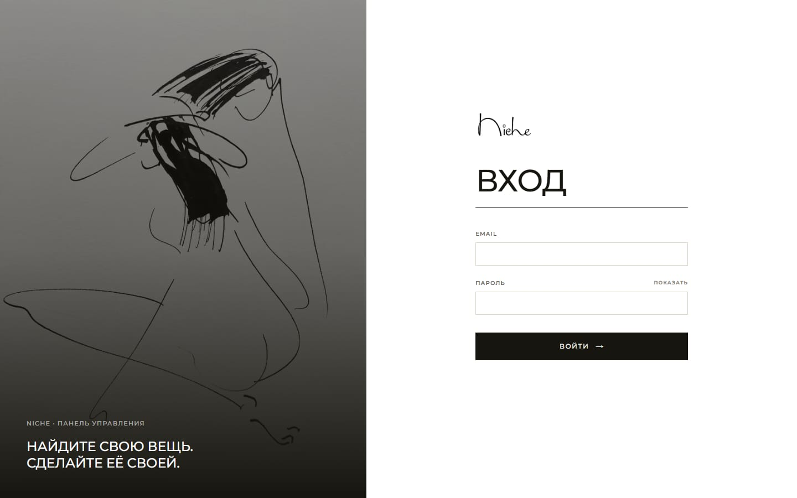 |

### Mobile

<p>
  
  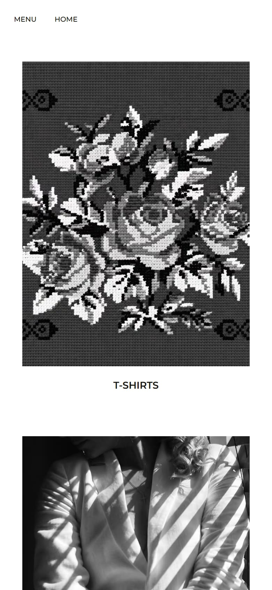
  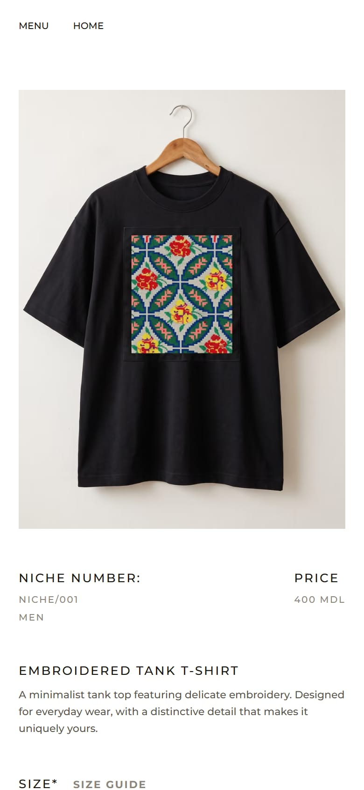
</p>

## Tech stack

- [Next.js 16](https://nextjs.org) (App Router, Server Actions, Turbopack), React 19, TypeScript
- [Supabase](https://supabase.com): Postgres, Auth with MFA, Storage
- [Tailwind CSS 4](https://tailwindcss.com) and [Motion](https://motion.dev) for animation
- [next-intl](https://next-intl.dev) for translations and routing
- [Zod](https://zod.dev) for validation, [sharp](https://sharp.pixelplumbing.com) for image processing
- Nodemailer or Resend for email, the Telegram Bot API for notifications
- Deployed on [Vercel](https://vercel.com)

## Getting started

### 1. Install

```bash
npm install
```

### 2. Set up Supabase

1. Create a project at [supabase.com](https://supabase.com).
2. Open **SQL Editor** and run [`supabase/schema.sql`](supabase/schema.sql). It creates the tables, security policies, storage buckets and starter content. It is safe to run again: re-running it upgrades an existing database in place.
3. Create your user in **Authentication → Users**, then make it an admin:

   ```sql
   insert into admins (user_id, email)
   select id, email from auth.users where email = 'you@example.com';
   ```

4. In **Authentication → URL Configuration**, set the Site URL to your site's address and add it to the redirect URLs. Password reset emails link back to it.

### 3. Environment variables

Create `.env.local` in the project root:

```bash
# Required
NEXT_PUBLIC_SITE_URL=http://localhost:3000
NEXT_PUBLIC_SUPABASE_URL=
NEXT_PUBLIC_SUPABASE_ANON_KEY=
SUPABASE_SERVICE_ROLE_KEY=        # server only, never expose to the browser

# Optional
SECRETS_KEY=                      # key for encrypting notification secrets
IP_HASH_SALT=                     # salt for hashing visitor IP addresses
```

Email and Telegram notifications are configured in **Admin → Settings**. They can also be set through `SMTP_*`, `RESEND_*` and `TELEGRAM_BOT_TOKEN` variables.

### 4. Run

```bash
npm run dev      # development server at http://localhost:3000
npm run build    # production build
npm run start    # serve the production build
npm run lint
```

## Project structure

```
app/
  [locale]/        public pages (home, collections, categories, products, custom, about, contacts)
  admin/           admin panel
  api/track/       visit statistics endpoint
  sitemap.ts       sitemap generated from the catalog
components/
  site/            storefront components and request forms
  admin/           admin panel components
lib/
  data/            catalog and content loading (cached, revalidated on admin saves)
  admin/           admin Server Actions and auth
  requests/        request form validation and submission
  security/        file sanitizing, rate limits, IP hashing, encryption
  seo/             page metadata and structured data
messages/          interface translations (ru, en)
supabase/          database schema
proxy.ts           locale routing, admin session refresh, security headers
```

## Deployment

The site deploys to Vercel on every push to `master`. Set the same environment variables in the Vercel project, with `NEXT_PUBLIC_SITE_URL` set to the public address. Mark `SUPABASE_SERVICE_ROLE_KEY` as a sensitive variable.
